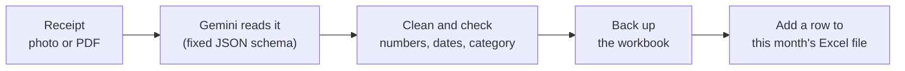

# Receipt Reader

Drop in a photo or PDF of a receipt. A vision model reads it, and the receipt becomes a row in that month's Excel ledger, filed under the right category.

## How it works



- **Structured output.** The request includes a response schema, so the model always answers with the same JSON fields instead of free text.
- **Cleaning rules.** Prices like `$1,234.50` become numbers, dates become real Excel dates, and a few fixed rules correct common category mix-ups.
- **Safe writes.** The month's workbook is copied to `data/backups/` before every change. Then the new row is added and the summary is rebuilt.

## Why Gemini

I chose Gemini because the Gemini API has a free tier, so anyone can try this with a free key from Google AI Studio without setting up billing. The free tier has rate limits that change over time. See Google's [pricing](https://ai.google.dev/gemini-api/docs/pricing) and [rate limits](https://ai.google.dev/gemini-api/docs/rate-limits) pages for the current numbers. The model is a setting (`GEMINI_MODEL`), and if the first model is busy the app tries a fallback.

## Run it

You need Python 3.10 or newer.

```bash
pip install -r requirements.txt
python run.py
```

On Windows you can double-click `start-windows.bat` instead, which runs both commands.

Your browser opens `http://localhost:8000`. Click **Settings**, paste a key from [aistudio.google.com/apikey](https://aistudio.google.com/apikey), and save. Then drag in the files from `samples/`. They are made-up receipts.

You can also put the key in a `.env` file instead. Copy `.env.example` to `.env` and fill in `GEMINI_API_KEY`.

## Tests

```bash
pip install -r requirements-dev.txt
pytest
```

The tests never call the real API. They feed scripted model answers through the whole pipeline and check the cleaning rules, the category rules, the PDF page split, the sheet layout, the summary totals and the backups.

## Project layout

```
app/
  extract.py   prompt, response schema, Gemini call, cleaning and category rules
  ledger.py    Excel workbook, sheets, summary, backups
  pdf.py       PDF pages to images (pypdfium2, no extra install)
  server.py    FastAPI routes for the web page
  config.py    settings, API key, data folders
  static/      the web page
samples/       made-up receipts to try
tests/         pytest tests with a fake Gemini
run.py         starts the app
```

## Privacy

- The app only listens on `127.0.0.1`, so other computers on your network can't reach it.
- Ledgers, processed receipts and backups stay in `data/`, which git ignores.
- Your API key stays in `settings.json` or `.env`, which git also ignores. It is sent to Google in a request header, never in the URL.
- Receipt images are sent to the Gemini API to be read. On the free tier, Google may use that data to improve its products, so don't upload receipts you aren't allowed to share.

## Built with

Python, FastAPI, Google Gemini API, openpyxl, pypdfium2, pytest
